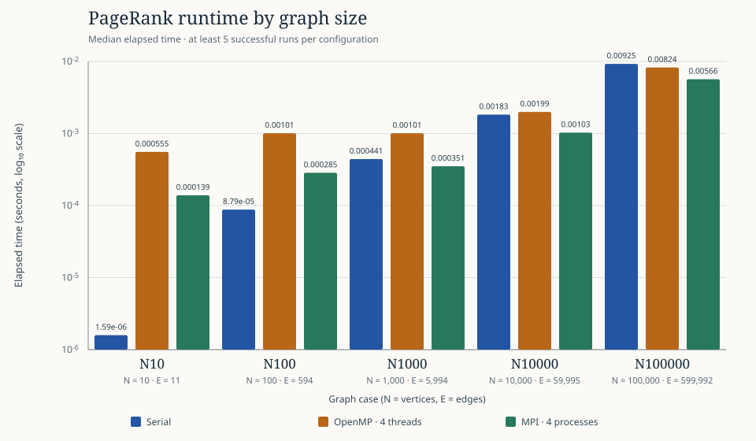
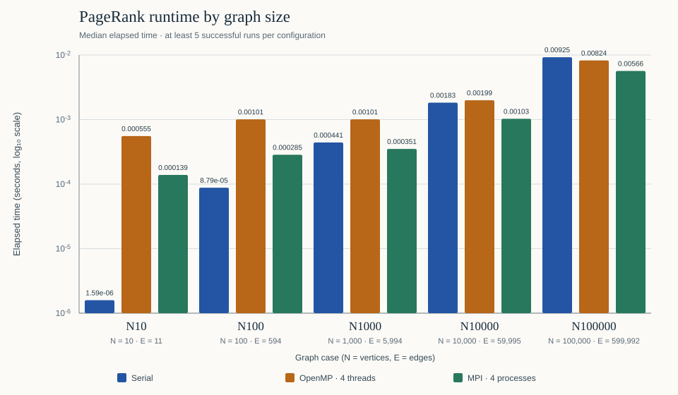

# Module III — PageRank with MPI (Questions 6–11)

This submission addresses the MPI module of Assignment 2. PageRank is computed on a directed graph in incoming-CSR form. Each iteration uses the current rank vector, redistributes dangling-node rank uniformly, and updates all destinations. The serial and OpenMP implementations are the corresponding Module I/II implementations in this project and are used as comparison baselines; this comparison does **not** assert that their source is byte-for-byte the same as a historical Assignment 1 submission. The assignment PDF labels Q9a “using OpenMP” under the MPI heading; this section follows the heading and implements MPI.

## Q6. Parallelizable blocks — Foster’s PCAM methodology

For a fixed iteration, the new rank of each destination is independent after the previous rank vector and total dangling mass are known. Iterations are dependent: the new vector from iteration *k* is required by iteration *k+1*. The global L1 convergence test also requires a reduction before all processes can make the same stop/continue decision.

1. **Partitioning.** Split destination vertices into contiguous, nearly equal ownership ranges. For process `p` of `P`, the range is `[floor(Np/P), floor(N(p+1)/P))`. The independently parallel tasks are the incoming-edge rank sum and new-rank calculation for each owned destination; owned vertices also contribute to local dangling mass and local L1 error.
2. **Communication.** Before updates, `MPI_Allreduce(SUM)` combines local dangling mass. After local destination updates, `MPI_Allgatherv` assembles the complete next rank vector on every process. A second `MPI_Allreduce(SUM)` combines L1 error for the common convergence decision. On exit, `MPI_Reduce(MAX)` reports the maximum elapsed process time to rank 0.
3. **Agglomeration.** Group all destination updates and CSR incoming-edge scans in a process’s range into one local work block per iteration. Communicate once at iteration boundaries rather than per edge or vertex. The program retains a replicated graph and rank vectors; this agglomeration therefore groups computation, not graph storage.
4. **Mapping.** Map each contiguous block to one MPI process. For the N=10, P=4 demonstration below, the ownership blocks are `[0,2)`, `[2,5)`, `[5,7)`, and `[7,10)`. Each process builds/stores the same graph and full current vector, and computes only its owned destinations.

```text
PROBLEM: directed PageRank on N destinations
       │
       └─ Partition destinations / vertex-update tasks
              [0..b1) [b1..b2) ... [b(P-1)..N)
                         │
                         └─ Communication dependencies
                            dangling-mass Allreduce
                            next-rank Allgatherv
                            L1-error Allreduce
                                      │
                                      └─ Agglomerate each process's owned
                                         destination updates + CSR scans
                                                │
                                                └─ Map blocks to processes
                                                   MPI rank 0: block 0
                                                   MPI rank 1: block 1
                                                   ...
                                                   MPI rank P-1: block P-1

Iteration dependency: rank(k) → rank(k+1) → rank(k+2) → ...
```

The diagram follows the assignment’s required PCAM sequence—problem, partitioning, communication, agglomeration, mapping—and names the actual MPI collectives and work blocks.

## Q7. MPI pseudocode

The algorithm below reflects the collective order and timing scope in [`c/mpi_pagerank.c`](c/mpi_pagerank.c) and the shared constants in [`c/shared_graph.h`](c/shared_graph.h): damping `d=0.85`, L1 tolerance `1e-6`, and maximum `10,000` iterations.

```text
MPI_Init; obtain process rank p and process count P
Every process constructs and validates the same incoming-CSR graph G(N,E)
begin = floor(N*p/P); end = floor(N*(p+1)/P)  // owned destinations [begin,end)
Initialize rank[v] = 1/N for every vertex; allocate next and local_values
For every process q:
    counts[q] = floor(N*(q+1)/P) - floor(N*q/P)
    displacements[q] = floor(N*q/P)

MPI_Barrier
start = MPI_Wtime()
for iteration = 1 .. 10,000:
    local_dangling = sum(rank[v] for v in [begin,end) when out_degree[v] = 0)
    dangling = MPI_Allreduce(local_dangling, SUM)
    base = (1-d)/N + d*dangling/N
    for each owned destination v in [begin,end):
        incoming = sum(rank[u]/out_degree[u] for each CSR edge u → v)
        local_values[v-begin] = base + d*incoming
    MPI_Allgatherv(local_values, counts, displacements, next)
    local_error = sum(abs(next[v]-rank[v]) for v in [begin,end))
    error = MPI_Allreduce(local_error, SUM)
    swap(rank, next); iterations = iteration
    if error < 1e-6: break

local_elapsed = MPI_Wtime() - start
elapsed = MPI_Reduce(local_elapsed, MAX, root=0)
Rank 0 prints N,E,iterations,elapsed,status,final_L1_error and optional ranks
Free allocated memory; MPI_Finalize
```

## Q8. MPI solution demonstration — N=10, first iteration

Take the explicit 10-vertex, 11-edge directed graph from the test fixture and [`c/shared_graph.h`](c/shared_graph.h#L181-L188):

```text
0→1, 0→2, 1→2, 2→0, 3→0, 3→2, 4→3, 4→5, 6→7, 7→8, 8→6
```

The initial rank of every vertex is `0.1`. Its outgoing degrees are `out(0)=2`, `out(1)=1`, `out(2)=1`, `out(3)=2`, `out(4)=2`, `out(5)=0`, `out(6)=out(7)=out(8)=1`, and `out(9)=0`. Thus vertices 5 and 9 are dangling. Incoming lists (empty lists shown as `∅`) are:

| Destination | Incoming source vertices |
|---:|:---|
| 0 | 2, 3 |
| 1 | 0 |
| 2 | 0, 1, 3 |
| 3 | 4 |
| 4 | ∅ |
| 5 | 4 |
| 6 | 8 |
| 7 | 6 |
| 8 | 7 |
| 9 | ∅ |

With four processes, the owned ranges and first-step dangling contributions are:

| MPI process | Owned vertices | Local dangling rank |
|---:|:---:|---:|
| 0 | `[0,2)` | 0 |
| 1 | `[2,5)` | 0 |
| 2 | `[5,7)` | 0.1 (vertex 5) |
| 3 | `[7,10)` | 0.1 (vertex 9) |
| **Global** | `[0,10)` | **0.2** |

Allreduce gives `D=0.2`. The common base term is `((1−0.85)/10) + (0.85×0.2/10) = 0.032`. Applying `next[v] = base + 0.85 × Σ(rank[u]/out_degree[u])` over the incoming list yields:

| v | Incoming contribution before damping | `next[v]` |
|---:|:---|---:|
| 0 | `0.1/1 + 0.1/2 = 0.15` | 0.1595 |
| 1 | `0.1/2 = 0.05` | 0.0745 |
| 2 | `0.1/2 + 0.1/1 + 0.1/2 = 0.20` | 0.2020 |
| 3 | `0.1/2 = 0.05` | 0.0745 |
| 4 | 0 | 0.0320 |
| 5 | `0.1/2 = 0.05` | 0.0745 |
| 6 | `0.1/1 = 0.10` | 0.1170 |
| 7 | `0.1/1 = 0.10` | 0.1170 |
| 8 | `0.1/1 = 0.10` | 0.1170 |
| 9 | 0 | 0.0320 |

Therefore the first update is **`[0.1595, 0.0745, 0.202, 0.0745, 0.032, 0.0745, 0.117, 0.117, 0.117, 0.032]`**. Its L1 change from the initial vector is `Σ|next[v]−0.1| = 0.425`. The rank vector is gathered across processes before convergence is assessed.

This first-step vector is checked by the integration test’s independent edge/reference calculation and by a separate one-iteration build of the serial and MPI programs ([runner](tests/test_pagerank.py#L206-L227), [test results](outputs/test_results.txt)). A four-process capped MPI run produced the [saved actual output](outputs/n10_first_iteration.txt); it exits with status 1 intentionally because reaching the compile-time iteration cap is reported as `max_iterations`:

```text
10,11,1,0.000027189,max_iterations,0.42499999999999999
ranks,0.1595,0.074500000000000011,0.20200000000000001,0.074500000000000011,0.032000000000000001,0.074500000000000011,0.11700000000000001,0.11700000000000001,0.11700000000000001,0.032000000000000001
```

For the converged two-process run, the actual raw MPI log records:

```text
10,11,25,0.000064743,success,5.6465066086697213e-07
ranks,0.21036722214068665,0.10830075012743358,0.21179967062274907,0.026924893717531297,0.018894662257914793,0.026924893717531297,0.12596441505274619,0.12596441505274619,0.12596441505274619,0.018894662257914793
```

This is the MPI/2 attempt recorded in [`outputs/mpi_output.txt`](outputs/mpi_output.txt#L109-L113), not an invented or hand-calculated converged result. The benchmark’s independently parsed N10 rows also report 25 iterations and final residual `5.646506608669721e-7` for every implementation/worker count ([comparison data](outputs/comparison.csv#L2-L50)).

## Q9. MPI implementation, execution, and outputs

The implementation is [`c/mpi_pagerank.c`](c/mpi_pagerank.c); graph allocation, deterministic generation, explicit N10 edges, CLI options, and shared PageRank constants are in [`c/shared_graph.h`](c/shared_graph.h). The implementation replicates the graph and full rank vectors, computes a contiguous vertex range on each rank, and produces one CSV result row; `--emit-ranks` adds a second `ranks,...` row. It builds with the recorded compiler options:

```sh
mpicc -O2 -std=c11 -Wall -Wextra -pedantic c/mpi_pagerank.c -o outputs/bin/mpi_pagerank
mpirun -np 2 outputs/bin/mpi_pagerank --case N10 --emit-ranks
mpirun -np 4 outputs/bin/mpi_pagerank --case N100000 --emit-ranks
```

For benchmark reproduction, build the three implementations and run the project runner (one warmup followed by five successful timed readings per configuration):

```sh
gcc -O2 -std=c11 -Wall -Wextra -pedantic c/serial_pagerank.c -o outputs/bin/serial_pagerank
gcc -O2 -std=c11 -Wall -Wextra -pedantic -fopenmp c/openmp_pagerank.c -o outputs/bin/openmp_pagerank
mpicc -O2 -std=c11 -Wall -Wextra -pedantic c/mpi_pagerank.c -o outputs/bin/mpi_pagerank
python3 tests/test_pagerank.py
python3 scripts/benchmark.py
```

The actual N10/2-process output is shown in Q8. The result row has six comma-separated fields—`N,E,iterations,seconds,status,final_L1_error`—followed by a `ranks,...` row when `--emit-ranks` is requested.

The N10 fixture and each case’s successful timed results agree in rank sum and rank vector across serial, OpenMP, and MPI. The current benchmark and test results are summarized below; iterations and final residual are from the recorded result CSVs, not extrapolated. MPI process counts are 1, 2, and 4 for each case.

| Case | N | E | Iterations | Final L1 residual | MPI process counts |
|:---|---:|---:|---:|---:|:---|
| N10 | 10 | 11 | 25 | 5.6465066e-7 | 1, 2, 4 |
| N100 | 100 | 594 | 56 | 9.4587330e-7 | 1, 2, 4 |
| N1000 | 1,000 | 5,994 | 43 | 8.8181542e-7 | 1, 2, 4 |
| N10000 | 10,000 | 59,995 | 30 | 8.7482626e-7 | 1, 2, 4 |
| N100000 | 100,000 | 599,992 | 16 | 9.6722143e-7 | 1, 2, 4 |

Run-level output and rank validation are available in [`outputs/serial_results.csv`](outputs/serial_results.csv), [`outputs/openmp_results.csv`](outputs/openmp_results.csv), [`outputs/mpi_results.csv`](outputs/mpi_results.csv), and the consolidated [`outputs/comparison.csv`](outputs/comparison.csv). The test runner reports **6/6 passed, 0 failures, 0 errors, 0 skipped** ([test record](outputs/test_results.txt)).

## Q10. MPI time and space analysis

Let `N` be the vertex count, `E` the edge count, `I` the number of iterations, and `P` the process count. Serial work is `O(I(N+E))`; OpenMP shares the graph and parallelizes vertex scans and updates, subject to thread overhead. In MPI, each iteration scans owned vertices for dangling rank and L1 error and scans the incoming edges of owned destinations. With balanced vertex and edge work, local computation per process is approximately `O(I(N+E)/P)`. If incoming-edge work is uneven, contiguous vertex ranges can have unequal loads; elapsed iteration time is determined by the slowest process. The `I` iterations remain sequentially dependent.

Each MPI process stores the complete incoming CSR graph (`O(N+E)`), current and next full rank vectors (`O(N)`), and its local update array (`O(N/P)`); thus memory is **`O(N+E)` per process** and `O(P(N+E))` across processes, not sharded `O((N+E)/P)` memory. Every iteration performs two scalar sum all-reductions and one all-gather that assembles `N` rank values on **each** process. Synchronization and data movement can limit scaling. A more detailed communication time depends on MPI collective algorithms, process placement, network topology, and message sizes; the measured single-machine runs do not establish a universal network-cost formula.

Graph construction and process startup are outside the timed region. The MPI timer starts after an `MPI_Barrier`, includes the iterative computation and collectives, and each run reports the maximum elapsed time across processes ([timer and reduction](c/mpi_pagerank.c#L63-L106)).

## Q11. Execution-time comparison

The benchmark was just run for all five graph sizes and all reported configurations: one warmup and **five successful timed repetitions per configuration**, with zero failed benchmark runs. Values below are current-run data from [`outputs/comparison.csv`](outputs/comparison.csv), which consolidates the per-implementation CSV files. Each timing cell lists **median / minimum / IQR**, in seconds; IQR is the recorded third quartile minus first quartile. The selected comparison columns are serial, OpenMP/4, and MPI/1, MPI/2, MPI/4. OpenMP uses `OMP_NUM_THREADS` equal to its worker count and `OMP_DYNAMIC=FALSE`. Graph generation is outside the timer; MPI reports the maximum process elapsed time.

| Case (N, E) | Serial (median / min / IQR, s) | OpenMP/4 (s) | MPI/1 (s) | MPI/2 (s) | MPI/4 (s) |
|:---|:---|:---|:---|:---|:---|
| N10 (10, 11) | 1.587e-6 / 1.219e-6 / 4.450e-7 | 5.548e-4 / 5.084e-4 / 1.723e-4 | 2.130e-5 / 2.056e-5 / 1.006e-6 | 6.474e-5 / 5.679e-5 / 9.345e-6 | 1.387e-4 / 1.078e-4 / 2.643e-5 |
| N100 (100, 594) | 8.786e-5 / 7.630e-5 / 5.640e-6 | 1.008e-3 / 9.824e-4 / 6.600e-6 | 6.634e-5 / 6.358e-5 / 1.040e-5 | 1.163e-4 / 1.152e-4 / 4.882e-5 | 2.849e-4 / 2.162e-4 / 4.864e-5 |
| N1000 (1,000, 5,994) | 4.410e-4 / 2.294e-4 / 3.855e-4 | 1.009e-3 / 9.328e-4 / 4.180e-4 | 2.964e-4 / 2.934e-4 / 1.405e-5 | 2.561e-4 / 2.399e-4 / 1.012e-4 | 3.508e-4 / 2.924e-4 / 4.635e-5 |
| N10000 (10,000, 59,995) | 1.830e-3 / 1.662e-3 / 6.944e-4 | 1.991e-3 / 1.793e-3 / 1.913e-4 | 1.930e-3 / 1.916e-3 / 1.473e-4 | 1.255e-3 / 1.197e-3 / 7.541e-5 | 1.029e-3 / 1.024e-3 / 6.186e-5 |
| N100000 (100,000, 599,992) | 9.252e-3 / 8.939e-3 / 1.484e-3 | 8.243e-3 / 6.786e-3 / 3.217e-3 | 1.114e-2 / 1.069e-2 / 4.073e-4 | 6.543e-3 / 6.029e-3 / 2.018e-4 | 5.660e-3 / 4.734e-3 / 4.846e-4 |

For reference, median times and speedups for all OpenMP and MPI worker counts are included in the generated [`report.md`](report.md#L29-L57). The graphs below plot the selected serial, OpenMP/4 and MPI/4 medians on a logarithmic seconds axis; both are outputs of the current benchmark.





### Speedup and efficiency relative to serial

Here `speedup = serial median / parallel median` and `efficiency = speedup / worker count`. Each cell gives **speedup × / efficiency**. An MPI process and an OpenMP thread are different execution resources, so cross-model speedups alone do not establish equal-cost scaling.

| Case | OpenMP/4 | MPI/1 | MPI/2 | MPI/4 |
|:---|:---:|:---:|:---:|:---:|
| N10 | 0.003× / 0.001 | 0.074× / 0.074 | 0.025× / 0.012 | 0.011× / 0.003 |
| N100 | 0.087× / 0.022 | 1.324× / 1.324 | 0.755× / 0.378 | 0.308× / 0.077 |
| N1000 | 0.437× / 0.109 | 1.488× / 1.488 | 1.722× / 0.861 | 1.257× / 0.314 |
| N10000 | 0.919× / 0.230 | 0.948× / 0.948 | 1.459× / 0.729 | 1.778× / 0.444 |
| N100000 | 1.122× / 0.281 | 0.831× / 0.831 | 1.414× / 0.707 | 1.635× / 0.409 |

For N10, parallel overhead dominates: every OpenMP/4 and MPI configuration is slower than serial. At N100000, MPI/4 is 1.635× faster than serial in this run, but still far from ideal four-process scaling. These observations reflect measured timing and communication/coordination overhead, not a change to PageRank's asymptotic work.

### MPI scaling relative to MPI/1

MPI strong-scaling speedup is `T_MPI/1 / T_MPI/P`; efficiency is that speedup divided by `P`. This uses the same MPI implementation as the baseline and is distinct from serial-relative speedup.

| Case | MPI/2 speedup | MPI/2 efficiency | MPI/4 speedup | MPI/4 efficiency |
|:---|---:|---:|---:|---:|
| N10 | 0.329× | 0.165 | 0.154× | 0.038 |
| N100 | 0.570× | 0.285 | 0.233× | 0.058 |
| N1000 | 1.157× | 0.579 | 0.845× | 0.211 |
| N10000 | 1.539× | 0.769 | 1.875× | 0.469 |
| N100000 | 1.702× | 0.851 | 1.968× | 0.492 |

### Correctness and environment

| Check / environment | Recorded result |
|:---|:---|
| Integration suite | 6 tests passed; 0 failures, 0 errors, 0 skipped ([record](outputs/test_results.txt)) |
| Generated benchmark | Five sizes; one warmup + five successful timed readings/configuration; 0 failed benchmark runs |
| Numerical validity | Ranks finite and nonnegative; sum within `1e-8` of 1; final L1 residual `<1e-6` |
| Cross-implementation comparison | Maximum rank delta `≤1e-8` in benchmark validation; tests use `5e-6` against independent reference to allow summation-order differences |
| Graph construction | Generated cases use `pair(k)=((N+1)k+17) mod N²`, skip self-loops, and have unique directed pairs; N10 is an explicit 11-edge fixture, not generated from the affine sequence |
| Machine | Linux x86_64; Intel Core Ultra 9 185H; 22 logical CPUs reported/available |
| Toolchain / MPI | GCC 16.2.1; Open MPI 5.0.10; `-O2 -std=c11 -Wall -Wextra -pedantic`; OpenMP adds `-fopenmp` |
| Runtime setup | OpenMP threads 1/2/4; MPI processes 1/2/4; no MPI root override used |

The algorithm preserves normalized PageRank: every vertex starts at `1/N`, dangling mass is redistributed uniformly, and the recorded converged rank sums are within `1e-8` of 1. For N10, the final rank vector is printed above in vertex order; it is not sorted separately, because each array position identifies its vertex.

The detailed environment, commands, timing boundaries, and validation definitions are recorded in [`outputs/metadata.txt`](outputs/metadata.txt); individual successful readings are in the three result CSVs linked above. Timings, especially microsecond-scale cases, are sensitive to system state and should be interpreted as this machine’s measurements, not general hardware-independent performance claims.
