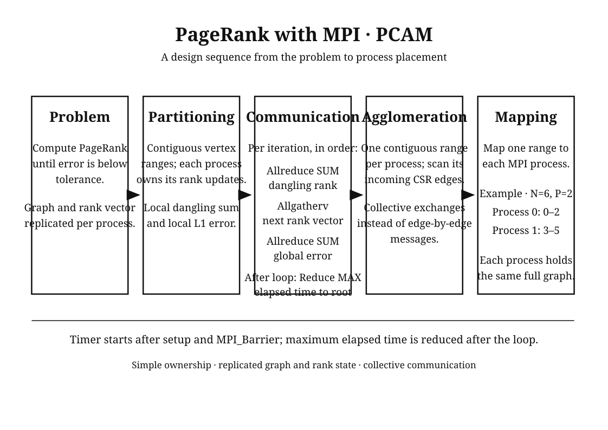
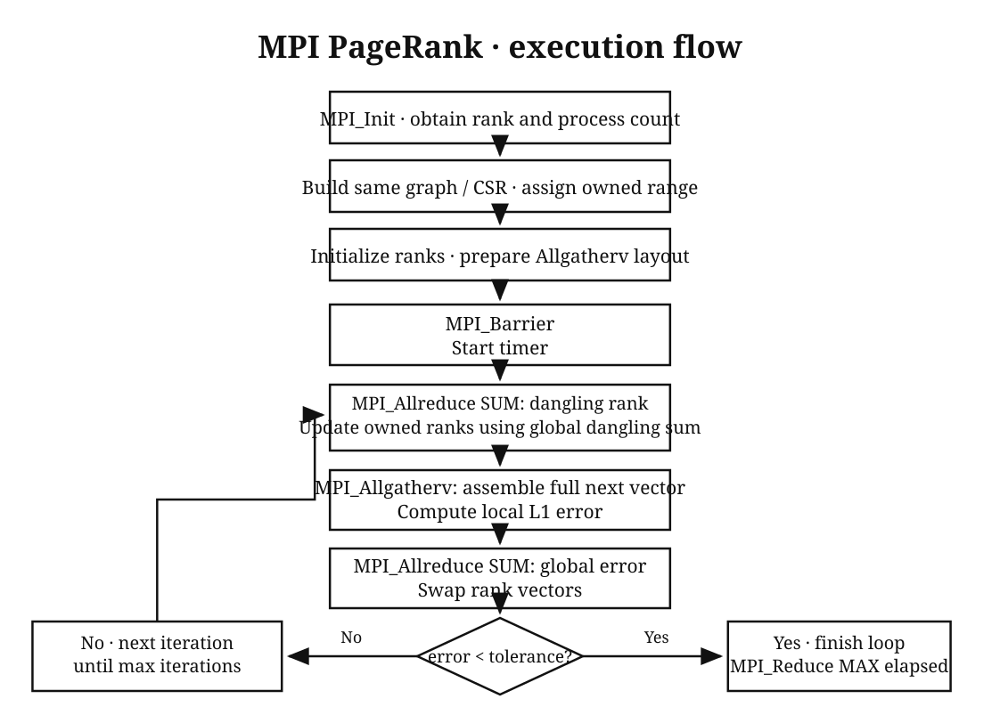
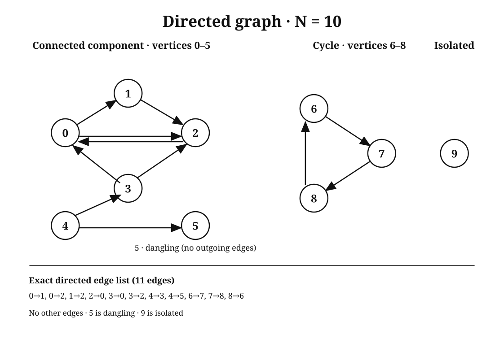

# Module III — MPI PageRank (Q6–Q11)

**Name:** Mohammed Ashar Husain  **Roll No.:** 2024bcs0137

PageRank uses damping `d = 0.85`; each vertex starts at `1/N`. A vertex with no outgoing edges is dangling; its rank is redistributed uniformly. Stop when the global L1 change is `< 10⁻⁶` (maximum 10,000 iterations).

## Q6. Parallelizable blocks — Foster PCAM

Each destination’s update is independent within an iteration, once the current ranks and total dangling rank are known. Iterations depend on one another, and all processes need the same global convergence decision.

Draw-by-hand reference: 

```text
┌────────────────────────────┐
│ PROBLEM: directed PageRank │
└─────────────┬──────────────┘
              ↓
┌────────────────────────────┐
│ PARTITION                  │
│ destination-vertex updates │
└─────────────┬──────────────┘
              ↓
┌────────────────────────────┐
│ COMMUNICATION              │
│ Allreduce dangling sum     │
│ Allgatherv new ranks       │
│ Allreduce L1 change        │
└─────────────┬──────────────┘
              ↓
┌────────────────────────────┐
│ AGGLOMERATION              │
│ group owned vertices and   │
│ their incoming-CSR scans    │
└─────────────┬──────────────┘
              ↓
┌────────────────────────────┐
│ MAPPING                    │
│ assign each block to rank p│
└────────────────────────────┘
```

For `N=10, P=4`, each process stores the same graph and full rank vector, but updates only its own range:

```text
Process 0: vertices 0–1  [0,2)
Process 1: vertices 2–4  [2,5)
Process 2: vertices 5–6  [5,7)
Process 3: vertices 7–9  [7,10)
```

The ranges are contiguous and nearly equal. The edges in a range’s incoming lists are scanned by that range’s owner.

## Q7. MPI pseudocode

Draw-by-hand reference: 

```text
MPI_Init; get rank p and process count P
Build and validate the same graph on every process
Set owned range [begin,end); initialize all ranks to 1/N
MPI_Barrier
start = MPI_Wtime()                 // timer starts before the loop
for iteration = 1 .. 10,000:
    local_dangling = sum current ranks of owned dangling vertices
    D = MPI_Allreduce(local_dangling, SUM)
    base = (1-d)/N + d*D/N
    for each owned destination v:
        next_local[v] = base + d * sum(rank[u]/out_degree[u]
                                       for each edge u → v)
    MPI_Allgatherv(next_local, next) // full next vector on every process
    local_L1 = sum |next[v]-rank[v]| over owned v
    L1 = MPI_Allreduce(local_L1, SUM)
    swap(rank, next)
    if L1 < 1e-6: break
local_elapsed = MPI_Wtime() - start
elapsed = MPI_Reduce(local_elapsed, MAX, root=0)
Rank 0 prints result; free memory; MPI_Finalize
```

## Q8. MPI demonstration: first iteration on N10

The directed graph below has `N=10, E=11`. Each short chain denotes only its consecutive arrows; separate groups are not connected. Vertex 5 and vertex 9 have no outgoing edge; vertex 9 is isolated.

Draw-by-hand reference: 

```text
0 → 1 → 2       0 → 2       2 → 0
3 → 0           3 → 2
4 → 3           4 → 5
6 → 7 → 8 → 6
```

Full edge list (same graph): `0→1, 0→2, 1→2, 2→0, 3→0, 3→2, 4→3, 4→5, 6→7, 7→8, 8→6`.

With four processes, initial rank is `0.1` per vertex:

| Rank | Owned range | Local dangling rank | First-step L1 contribution |
|---:|:---:|---:|---:|
| 0 | `[0,2)` | 0 | 0.085 |
| 1 | `[2,5)` | 0 | 0.1955 |
| 2 | `[5,7)` | 0.1 (vertex 5) | 0.0425 |
| 3 | `[7,10)` | 0.1 (vertex 9) | 0.102 |
| **Total** | `[0,10)` | **0.2** | **0.425** |

`base = (1−0.85)/10 + 0.85×0.2/10 = 0.032`. For example, vertex 0 receives ranks from 2 and 3, so `next[0] = 0.032 + 0.85(0.1/1 + 0.1/2) = 0.1595`. Vertex 2 receives from 0, 1 and 3, so `next[2] = 0.032 + 0.85(0.1/2 + 0.1/1 + 0.1/2) = 0.2020`. The gathered first update, in vertex order, is:

```text
v:    0       1       2       3       4       5       6       7       8       9
rank: .1595   .0745   .2020   .0745   .0320   .0745   .1170   .1170   .1170   .0320
```

Global L1 change is `0.085 + 0.1955 + 0.0425 + 0.102 = 0.425 > 10⁻⁶`, so iteration continues. The **actual capped one-iteration MPI result row** is below. It is not converged; the cap intentionally reports `max_iterations`. The full rank row is in `outputs/n10_first_iteration.txt`:

```text
10,11,1,0.000027189,max_iterations,0.42499999999999999
```

## Q9. MPI code, run, and actual output

MPI source: [`c/mpi_pagerank.c`](c/mpi_pagerank.c); graph, N10 edge fixture and constants: [`c/shared_graph.h`](c/shared_graph.h). Compile and run the converged two-process N10 case:

```sh
mpicc -O2 -std=c11 -Wall -Wextra -pedantic c/mpi_pagerank.c -o outputs/bin/mpi_pagerank
mpirun -np 2 outputs/bin/mpi_pagerank --case N10 --emit-ranks
```

Actual converged MPI/2 result row from `outputs/mpi_output.txt` (the full rank row is attached separately):

```text
10,11,25,0.000064743,success,5.6465066086697213e-07
```

The row is `N,E,iterations,seconds,status,final_L1_error`; the separate `ranks,...` row lists ranks in vertex order. For the submitted hardcopy, attach the **printed full source and output**, labelled with the name and roll number above; those identifiers are not printed by the program. The assignment PDF’s Q9a says “OpenMP” despite its MPI heading; this answer follows the heading and gives the MPI implementation.

## Q10. Time and space complexity

Let `N` be vertices, `E` edges, `I` iterations and `P` processes. Serial work is `O(I(N+E))`. With balanced work, MPI computation is approximately `O(I(N+E)/P)` per process. Add per-iteration collectives: two scalar `Allreduce`s and an `Allgatherv` of `N` ranks to every process. Imbalance and communication can limit speedup.

Every process stores the replicated CSR graph and full rank vectors: **`O(N+E)` memory per process**, hence **`O(P(N+E))` total**. The graph is not distributed among processes. The timer begins after a barrier, before the iteration loop; the reported elapsed time is the maximum across processes.

## Q11. Execution-time comparison

Median measured seconds; five timed readings per configuration. OpenMP/4 means four threads; MPI/2 and MPI/4 mean two and four processes. Values are from [`outputs/comparison.csv`](outputs/comparison.csv); the comparison graph is [`outputs/comparison.png`](outputs/comparison.png).

Graph to print or copy: 

| N (E) | Serial | OpenMP/4 | MPI/2 | MPI/4 |
|---:|---:|---:|---:|---:|
| 10 (11) | 1.587e−6 | 5.548e−4 | 6.474e−5 | 1.387e−4 |
| 100 (594) | 8.786e−5 | 1.008e−3 | 1.163e−4 | 2.849e−4 |
| 1,000 (5,994) | 4.410e−4 | 1.009e−3 | 2.561e−4 | 3.508e−4 |
| 10,000 (59,995) | 1.830e−3 | 1.991e−3 | 1.255e−3 | 1.029e−3 |
| 100,000 (599,992) | 9.252e−3 | 8.243e−3 | 6.543e−3 | 5.660e−3 |

For example, at `N=100,000`, MPI/4 speedup over serial is `0.009252 / 0.005660 = 1.635×`; efficiency is `1.635/4 = 0.409` (about 40.9%). For small graphs, parallel overhead can exceed the saved computation. These are measurements from this machine, not universal timings.

**Cross-check sources:** Assignment: [`2026-Assignment-2-Batch2-PDC.pdf`](2026-Assignment-2-Batch2-PDC.pdf); algorithm and graph: [`c/mpi_pagerank.c`](c/mpi_pagerank.c), [`c/shared_graph.h`](c/shared_graph.h); first step: [`outputs/n10_first_iteration.txt`](outputs/n10_first_iteration.txt); converged run: [`outputs/mpi_output.txt`](outputs/mpi_output.txt); timings and graph: [`outputs/comparison.csv`](outputs/comparison.csv), [`outputs/comparison.png`](outputs/comparison.png).
